# Minha Estante — Trabalho 3


**Aluno:** Davi Renato dos Santos Paixão Moreira
**Tema:** biblioteca pessoal e acompanhamento de leituras
**Tecnologias:** Flutter, Dart, Firebase Authentication e Cloud Firestore

**Repositório:** https://github.com/daviermac/minha-estante

O Minha Estante ajuda o leitor a organizar os livros que quer ler, está lendo ou já concluiu. O app foi evoluído em etapas no mesmo repositório: interface e modelo no T1, autenticação no T2 e persistência na nuvem com CRUD por usuário no T3.

## Funcionalidades acumuladas

**Trabalho 1 — base Flutter**
- Modelo `Livro` (título, autor, gênero, status de leitura e nota de 1 a 5).
- Telas de lista, cadastro com validação e detalhes do livro.

**Trabalho 2 — autenticação**
- Cadastro, login, logout e recuperação de senha com Firebase Authentication.
- Validação de formulários, loading, mensagens de erro em português.
- Proteção da área interna pelo estado de autenticação (`authStateChanges()`).

**Trabalho 3 — Cloud Firestore e CRUD por usuário**
- **CREATE:** o formulário cria um documento em `users/{uid}/books`.
- **READ:** a estante é carregada do Firestore com `snapshots()` e se atualiza sozinha após cada alteração.
- **UPDATE:** botão *Editar* nos detalhes; o mesmo formulário abre preenchido e grava as alterações.
- **DELETE:** botão *Excluir* com diálogo de confirmação; o documento é removido do Firestore.
- Loading na carga da lista e nos botões de salvar/excluir, com bloqueio de envios duplicados.
- Estado vazio com atalho para cadastrar o primeiro livro.
- Erros de permissão, conexão e operação traduzidos para mensagens compreensíveis, com opção de tentar novamente.
- Security Rules por UID, com validação dos campos, e testes automatizados das regras.

## Estrutura de dados no Firestore

```text
users/{uid}/books/{bookId}
```

O `uid` vem sempre da sessão do Firebase Authentication, nunca de um campo da tela. Exemplo de documento:

```json
{
  "title": "Dom Casmurro",
  "author": "Machado de Assis",
  "genre": "Romance",
  "status": "lendo",          // queroLer | lendo | concluido
  "rating": 4,                // 1 a 5
  "createdAt": "Timestamp do servidor",
  "updatedAt": "Timestamp do servidor"
}
```

## Regras de segurança

Arquivo [`firestore.rules`](firestore.rules):

- Leitura e exclusão somente quando `request.auth.uid == userId`.
- Criação e edição somente pelo dono e com dados válidos: apenas os campos esperados, textos não vazios, `status` dentro da lista, `rating` inteiro de 1 a 5 e datas geradas pelo servidor. `createdAt` não pode ser alterado na edição.
- Qualquer outro caminho do banco é negado (`allow read, write: if false`).

Testes das regras em [`test/firestore_rules`](test/firestore_rules), executados no Firebase Emulator:

```sh
cd test/firestore_rules
npm install
npm test
```

Resultado: 6 de 6 testes aprovados. A conta A lê, cria, edita e exclui os próprios livros. A conta B e usuários sem login recebem `PERMISSION_DENIED` ao tentar ler, criar, editar ou excluir livros da conta A. Dados inválidos e campos extras são recusados.

## Organização do código

```text
lib/
  main.dart                       inicialização do Firebase (Auth + Firestore)
  app.dart                        tema e proteção pelo estado da sessão
  firebase_options.dart           configuração por plataforma
  data/auth_repository.dart       Firebase Authentication e tradução de erros
  data/livro_repository.dart      CRUD no Firestore (users/{uid}/books) e tradução de erros
  domain/livro.dart               modelo Livro e conversão para o documento
  ui/auth/                        login, cadastro, recuperação e controller
  ui/library/library_area.dart    escuta da estante, navegação interna e ações do CRUD
  ui/library/library_screens.dart lista, formulário (criar/editar) e detalhes (editar/excluir)
firestore.rules                   regras de segurança
firebase.json                     regras e portas dos emuladores
test/auth_flow_test.dart          12 testes de widget (autenticação e CRUD)
test/firestore_rules/             testes das Security Rules
```

As telas não chamam o Firestore diretamente: tudo passa pela interface `LivroRepository`.

## Configurar e executar

Requisitos: Flutter 3.47+, Node.js e Firebase CLI (`npm install -g firebase-tools`).

```sh
flutter pub get
```

### Com um projeto Firebase real

1. No [Firebase Console](https://console.firebase.google.com/), crie o projeto, habilite **Authentication → E-mail/senha** e crie o **Firestore Database**.
2. Conecte o app: `dart pub global activate flutterfire_cli` e depois `flutterfire configure`. Outra opção, só para web, é preencher `firebase-config.local.json` a partir de `firebase-config.example.json`.
3. Publique as regras: `firebase use <id-do-projeto>` e depois `firebase deploy --only firestore:rules`.
4. Execute: `flutter run -d chrome`. Se usou o arquivo local, adicione `--dart-define-from-file=firebase-config.local.json`.

### Com o Firebase Local Emulator Suite (sem conta Google)

```sh
firebase emulators:start --only auth,firestore --project demo-minha-estante
flutter run -d chrome --dart-define-from-file=firebase-config.emulator.json
```

O emulador já carrega o `firestore.rules`, então as regras valem nos testes locais.

## Capturas (Firebase Emulator)

| Estado vazio | CREATE | READ (lista) |
|---|---|---|
| 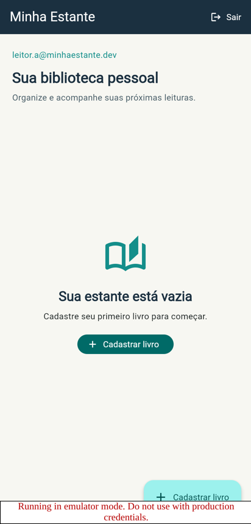 | 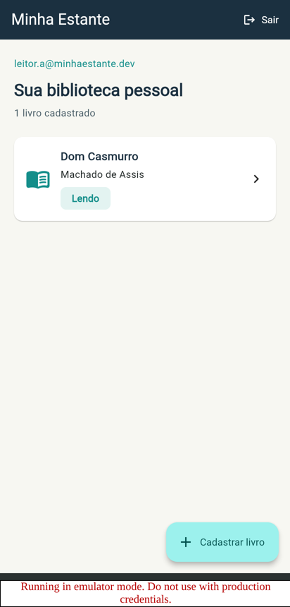 | 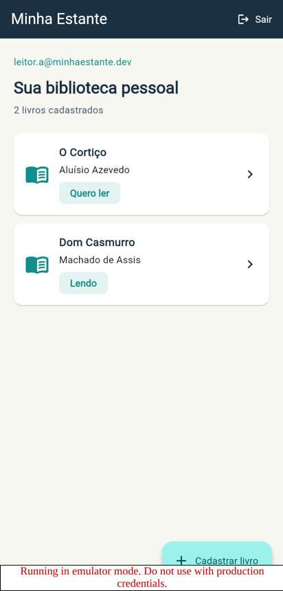 |
| **UPDATE (formulário)** | **UPDATE (salvo)** | **Reaberto: dados persistidos** |
| 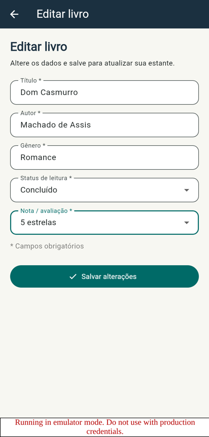 | 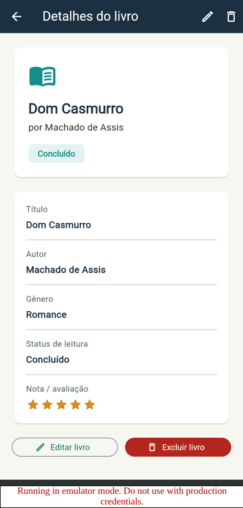 | 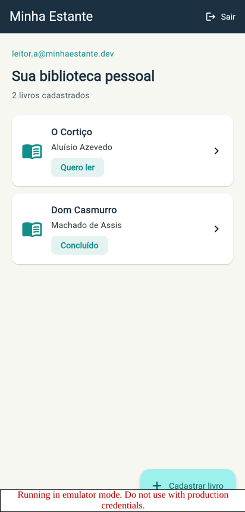 |
| **DELETE (confirmação)** | **DELETE (concluído)** | **Conta B: só os próprios livros** |
| 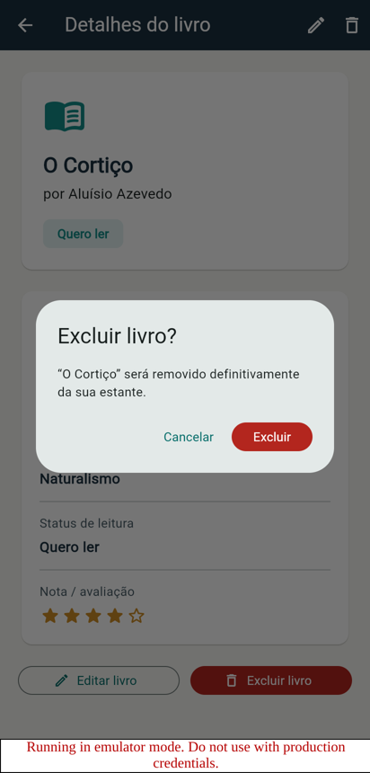 | 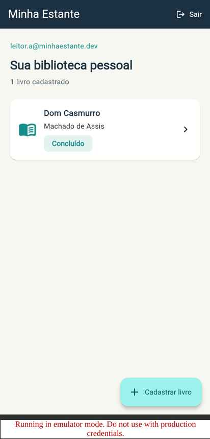 | 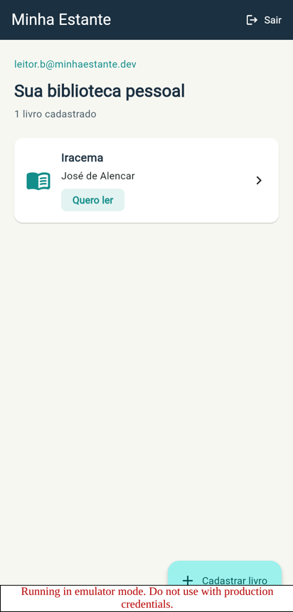 |
| **Loading ao salvar** | **Erro de conexão** | |
| 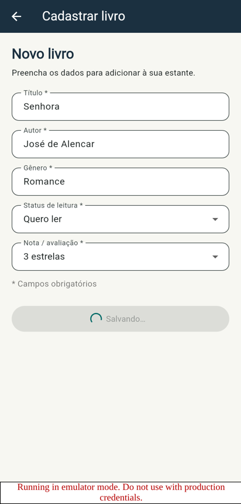 | 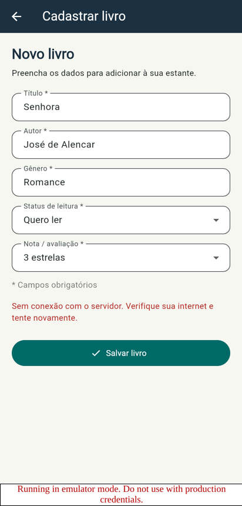 | |

## Verificação

```sh
dart format lib test
flutter analyze        # No issues found
flutter test           # 12 testes aprovados
cd test/firestore_rules && npm test   # 6 testes de regras aprovados
```

## Limitações conhecidas

- As capturas e os testes foram feitos no Firebase Local Emulator Suite (Auth + Firestore), não em um projeto Firebase na nuvem.
- No modo emulador web, a sessão não é restaurada ao recarregar a página. Por isso o teste de "fechar e abrir o app" foi feito com uma nova sessão do navegador e novo login; os dados continuaram lá.
- Se a conexão cair durante um salvamento, o app mostra o erro após 20 s. O SDK do Firestore pode manter a gravação na fila e enviá-la quando a conexão voltar.

## Próximas evoluções (Trabalho 4)

- Busca e filtros por status/gênero, ordenação por título ou nota.
- Capa do livro e progresso de leitura (páginas).
- Publicação em um projeto Firebase na nuvem e testes no Android.
