# Minha Estante — versão final (Trabalho 4)

**Aluno:** Davi Renato dos Santos Paixão Moreira
**Tema:** biblioteca pessoal e acompanhamento de leituras
**Tecnologias:** Flutter, Dart, Firebase Authentication, Cloud Firestore e Firebase Hosting

**App online:** https://minha-estante-daviermac.web.app
**Repositório:** https://github.com/daviermac/minha-estante

O Minha Estante ajuda o leitor a organizar os livros que quer ler, está lendo ou já concluiu. Cada pessoa cria a própria conta e enxerga apenas os próprios livros, que ficam salvos na nuvem.

O app foi construído em etapas, sempre no mesmo repositório:

| Etapa | O que entrou |
|---|---|
| Trabalho 1 | Modelo `Livro`, tema, lista, cadastro com validação e detalhes (dados em memória) |
| Trabalho 2 | Firebase Authentication: cadastro, login, logout, recuperação de senha e proteção das telas |
| Trabalho 3 | Cloud Firestore: CRUD por usuário em `users/{uid}/books`, Security Rules e testes de isolamento |
| Trabalho 4 | Projeto Firebase real, app publicado no Firebase Hosting, busca e filtro por status, resumo da estante e README final |

## Funcionalidades

**Autenticação (Firebase Authentication)**
- Criar conta com e-mail, senha e confirmação de senha.
- Entrar, sair e recuperar a senha por e-mail.
- Sessão restaurada automaticamente ao reabrir o app.
- Usuário sem login nunca vê a estante: o app decide a tela pelo estado da sessão.

**Livros (Cloud Firestore)**
- **CREATE:** cadastrar livro (título, autor, gênero, status e nota).
- **READ:** lista em tempo real com `snapshots()`; mudanças aparecem sem recarregar.
- **UPDATE:** editar um livro pelo botão *Editar* nos detalhes.
- **DELETE:** excluir com diálogo de confirmação.
- Busca por título ou autor e filtro por status (Todos, Quero ler, Lendo, Concluído).
- Resumo com total de livros e quantos foram concluídos.

**Estados da interface**
- Loading ao verificar a sessão, ao carregar a lista e nos botões de salvar, excluir, entrar e sair (com bloqueio de clique duplo).
- Estado vazio com botão para cadastrar o primeiro livro, e aviso quando a busca não encontra nada.
- Erros traduzidos para português: credenciais inválidas, e-mail já cadastrado, sem conexão, sem permissão e falha ao salvar.
- Formulários validados: e-mail, senha (mínimo 6), confirmação de senha e todos os campos do livro.

## Arquitetura

```text
┌──────────── UI (lib/ui) ─────────────┐   ┌──── Dados (lib/data) ────┐   ┌─ Firebase ─┐
│ AuthScreen ── AuthController ────────┼──▶│ AuthRepository           │──▶│ Auth       │
│ LibraryArea ─ EstanteTela            │   │ (FirebaseAuthRepository) │   │            │
│               FormularioLivroTela    ├──▶│ LivroRepository          │──▶│ Firestore  │
│               DetalhesLivroTela      │   │ (FirestoreLivroRepository)│  │            │
└──────────────────────────────────────┘   └──────────────────────────┘   └────────────┘
                      ▲ modelo compartilhado: lib/domain/livro.dart (Livro, StatusLeitura)
```

- **Telas** só montam a interface e chamam métodos. Nenhuma tela usa `FirebaseAuth` ou `FirebaseFirestore` diretamente.
- **Repositories** concentram as chamadas ao Firebase e convertem erros técnicos em mensagens para o usuário (`AuthFailure`, `LivroFailure`).
- **AuthController** (`ChangeNotifier`) controla o loading e o erro dos formulários de autenticação.
- **Estado:** a sessão é um `Stream` (`authStateChanges`) lido por um `StreamBuilder` em `app.dart`; a lista de livros é um `Stream` (`snapshots`) guardado num `ValueNotifier` em `LibraryArea`.
- Os testes usam implementações falsas dos repositories, o que só é possível porque as telas dependem das interfaces.

```text
lib/
  main.dart                        inicializa o Firebase e cria os repositories
  firebase_options.dart            identificadores do projeto Firebase (web)
  app.dart                         tema e "portão" que escolhe login ou estante pelo estado da sessão
  domain/livro.dart                modelo Livro, StatusLeitura e conversão para o documento
  data/auth_repository.dart        cadastro, login, logout, recuperação e mensagens de erro do Auth
  data/livro_repository.dart       CRUD em users/{uid}/books e mensagens de erro do Firestore
  ui/auth/auth_controller.dart     loading, erro e validações dos formulários de autenticação
  ui/auth/auth_screen.dart         telas de login, cadastro e recuperação de senha
  ui/library/library_area.dart     escuta a estante e liga as ações do CRUD às telas
  ui/library/library_screens.dart  estante (busca/filtro), formulário e detalhes
firestore.rules                    Security Rules
firebase.json / .firebaserc        configuração de Hosting, regras e emuladores
test/auth_flow_test.dart           13 testes de widget (autenticação, CRUD, busca e estados)
test/firestore_rules/              6 testes das Security Rules no emulador
```

## Firestore

```text
users/{uid}/books/{bookId}
```

O `uid` vem da sessão do Firebase Authentication (`user.uid`), nunca de um campo da tela. Exemplo de documento:

```json
{
  "title": "Dom Casmurro",
  "author": "Machado de Assis",
  "genre": "Romance",
  "status": "concluido",      // queroLer | lendo | concluido
  "rating": 5,                // 1 a 5
  "createdAt": "<timestamp do servidor>",
  "updatedAt": "<timestamp do servidor>"
}
```

## Security Rules

As regras em [`firestore.rules`](firestore.rules) estão publicadas no projeto `minha-estante-daviermac`:

- Ler e excluir: só se `request.auth.uid == userId`, ou seja, o dono do caminho.
- Criar e editar: só o dono, e com dados válidos. Isso quer dizer apenas os campos esperados, textos não vazios, status da lista, nota inteira de 1 a 5 e datas do servidor; `createdAt` não muda na edição.
- Qualquer outro caminho do banco: negado.

Teste no projeto real com duas contas (token da conta B tentando acessar o caminho da conta A pela API REST do Firestore):

```text
Conta A lista os próprios livros         -> 200 OK
Conta B lista os livros da conta A       -> 403 PERMISSION_DENIED
Conta B lê um livro da conta A           -> 403 PERMISSION_DENIED
Conta B altera um livro da conta A       -> 403 PERMISSION_DENIED
Conta B exclui um livro da conta A       -> 403 PERMISSION_DENIED
Sem login: lista os livros da conta A    -> 403 PERMISSION_DENIED
```

## Como executar

**Usar online:** abra https://minha-estante-daviermac.web.app e crie uma conta.

**Rodar o código** (Flutter 3.47, Dart 3.13):

```sh
flutter pub get
flutter run -d chrome
```

O app já aponta para o projeto Firebase `minha-estante-daviermac` (veja `lib/firebase_options.dart`). Para usar outro projeto: crie-o no Firebase Console, habilite **Authentication → E-mail/senha** e o **Firestore**, e rode `flutterfire configure`.

**Publicar regras e app** (Firebase CLI):

```sh
flutter build web --release
firebase deploy --only firestore:rules,hosting
```

**Testes:**

```sh
flutter analyze
flutter test                                   # 13 testes
cd test/firestore_rules && npm install && npm test   # 6 testes das regras (emulador)
```

**Rodar com emuladores locais (opcional):**

```sh
firebase emulators:start --only auth,firestore
flutter run -d chrome --dart-define-from-file=firebase-config.emulator.json
```

## Screenshots (projeto real)

| Login | Validação | Cadastro | Estante vazia |
|---|---|---|---|
| 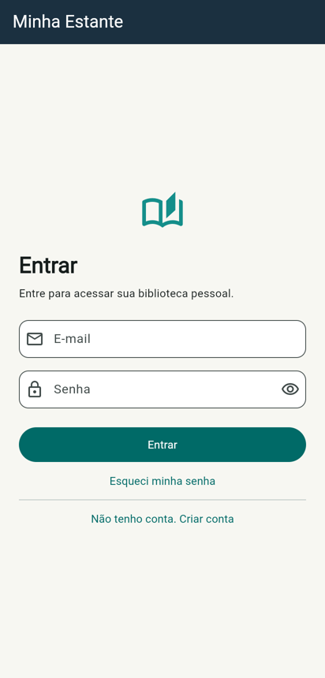 | 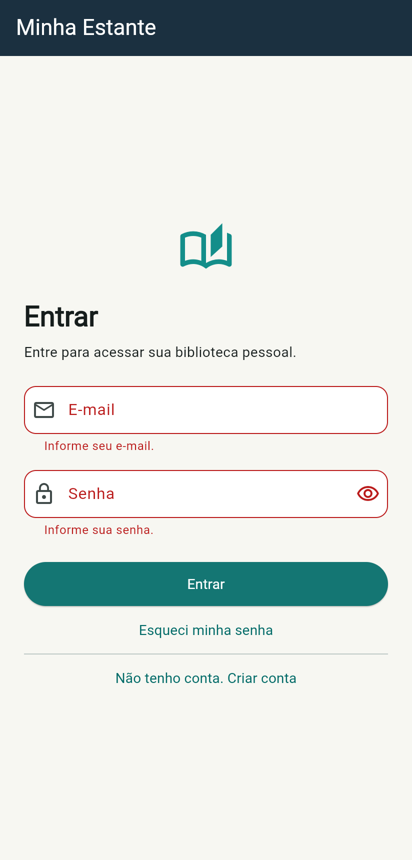 | 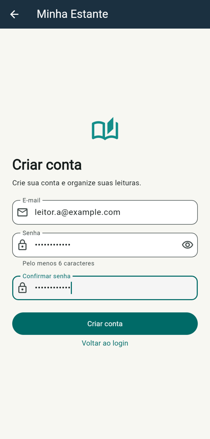 | 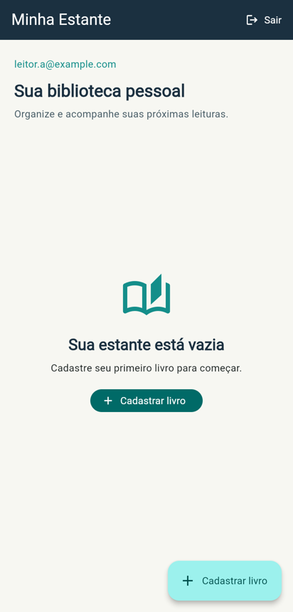 |
| **CREATE** | **READ** | **Filtro por status** | **Detalhes** |
| 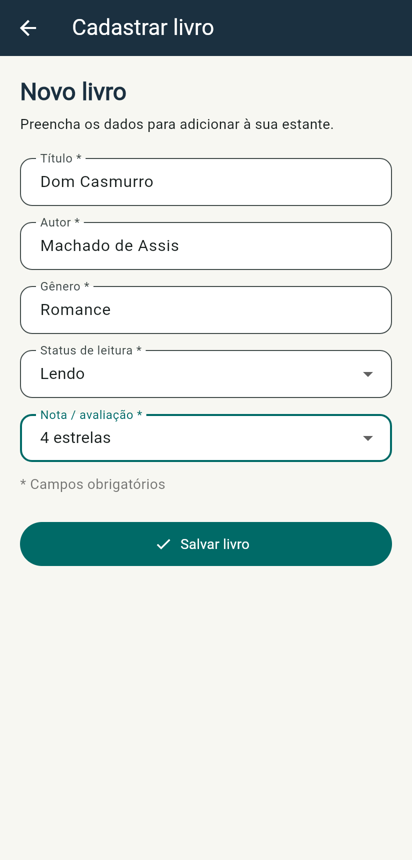 | 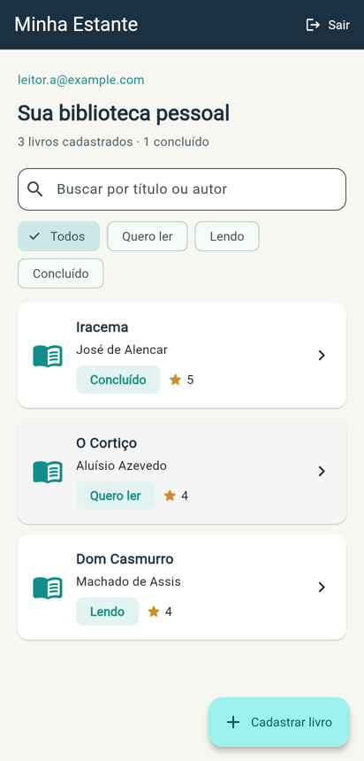 | 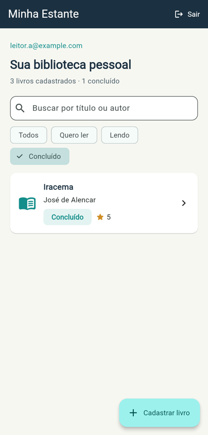 | 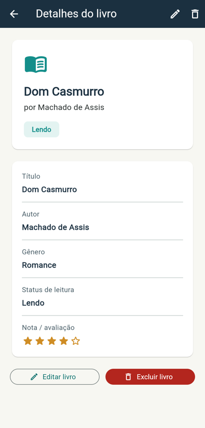 |
| **UPDATE** | **UPDATE salvo** | **DELETE (confirmação)** | **DELETE concluído** |
| 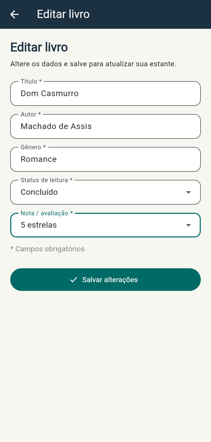 | 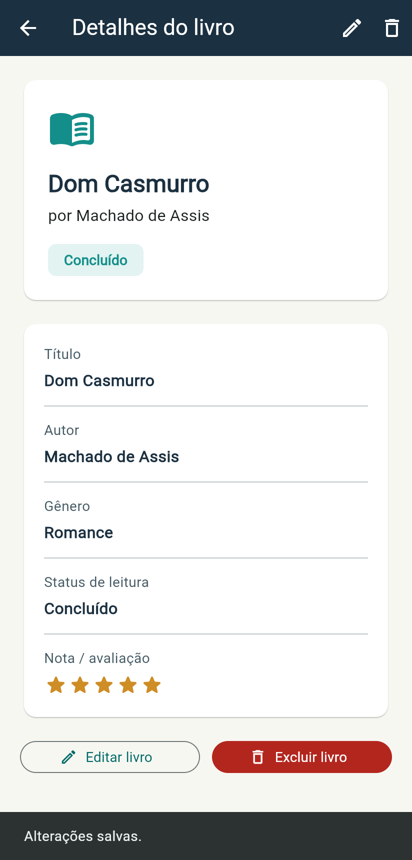 | 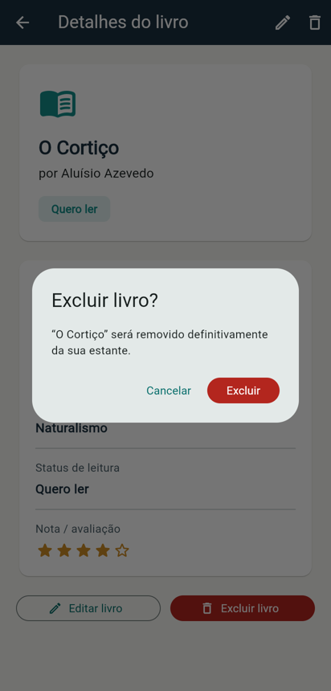 | 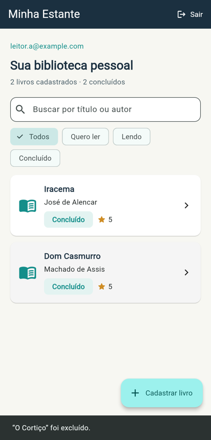 |
| **Login inválido** | **Recuperação de senha** | **Conta B isolada** | **Erro de conexão** |
| 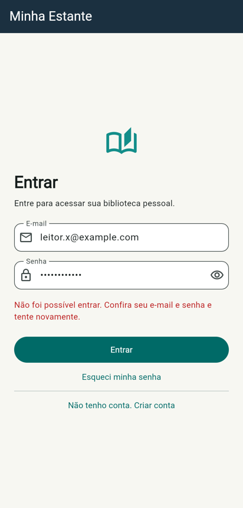 | 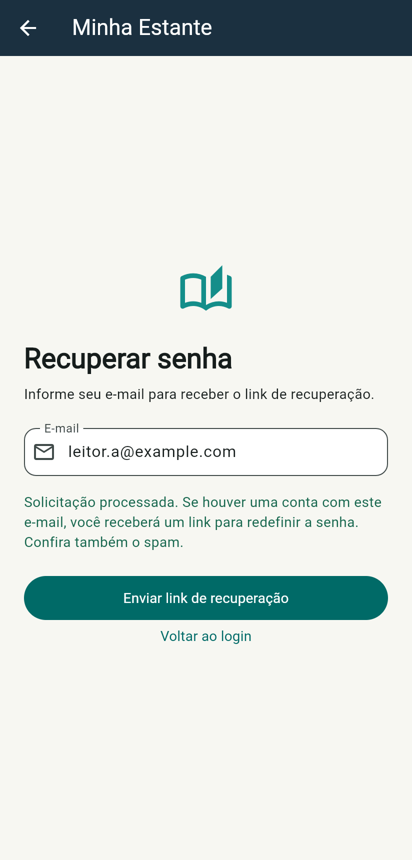 | 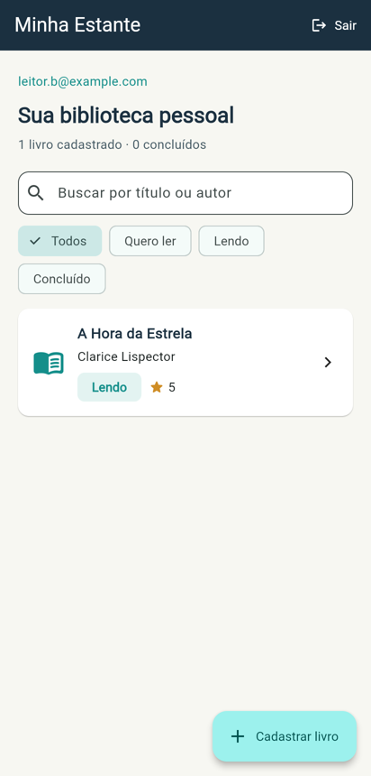 | 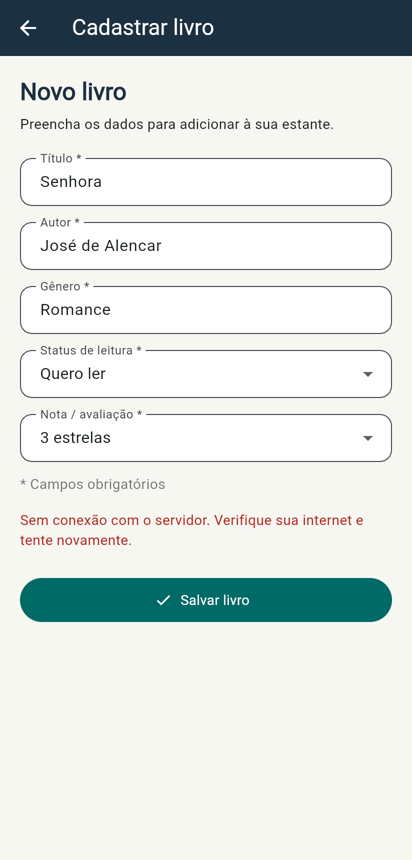 |

## Limitações conhecidas

- A configuração do Firebase está gerada para Web. Para Android/iOS é preciso rodar `flutterfire configure` com essas plataformas.
- Se a conexão cair durante um salvamento, o app avisa após 20 s, mas o SDK do Firestore pode manter a gravação na fila e enviá-la quando a conexão voltar.
- O e-mail de recuperação depende de o endereço existir (as contas de teste usam `example.com`).
